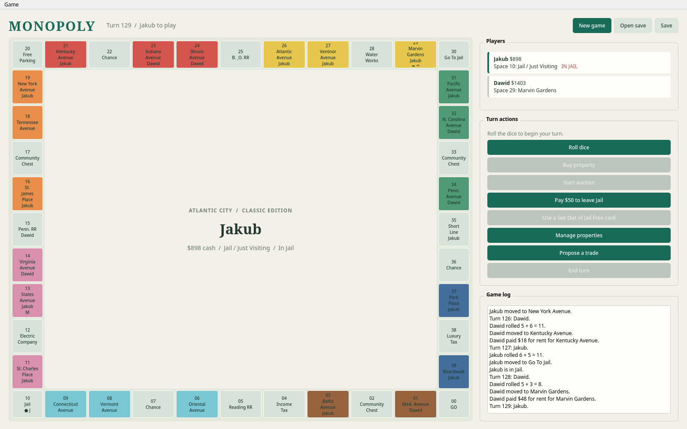
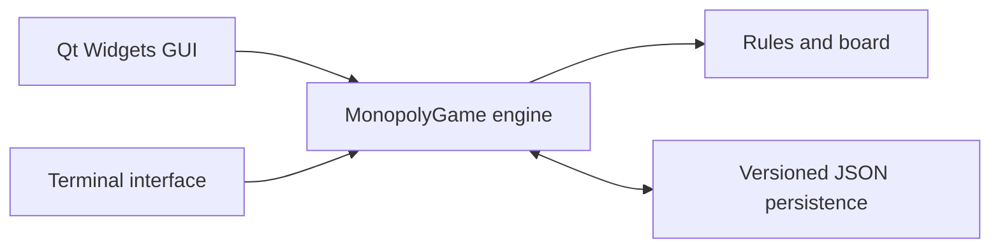

# MONOPOLY - Classic Board Game in Python 🎩

<p align="center">
  
</p>

<p align="center">
  
  
  
  
</p>

**Monopoly** is a local, turn-based board game for 2-4 players. It combines a Qt Widgets desktop interface with a separately testable rules engine and portable JSON save files.

The game follows the `us-classic-2008-2021` rules profile on the classic 40-space Atlantic City board. It runs on Windows, macOS, and Linux with Python 3.11 or newer.

## 📚 Table of Contents

- [Features](#features)
- [Technology Stack](#technology-stack)
- [Screenshot](#screenshot)
- [Rules and Economy](#rules-and-economy)
- [Architecture](#architecture)
- [Quick Start](#quick-start)
- [Saving and Loading](#saving-and-loading)
- [Testing](#testing)
- [Useful Commands](#useful-commands)
- [Project Structure](#project-structure)
- [What I Learned](#what-i-learned)
- [Future Improvements](#future-improvements)
- [Legal Notice](#legal-notice)

<a id="features"></a>

## ✨ Features

- **Local multiplayer** for 2-4 players sharing one computer.
- **Qt desktop interface** with a clickable board, player standings, turn controls, and game history.
- **Complete 40-space board** with property ownership, player positions, buildings, and mortgage indicators.
- **Property purchases and auctions**, including auctions for properties returned to the Bank after bankruptcy.
- **Classic property economy** with street, railroad, and utility rent, color-group bonuses, houses, hotels, and mortgages.
- **Turn and Jail rules** including doubles, extra turns, the third-double rule, Jail fees, and Get Out of Jail Free cards.
- **Property management** for building and selling evenly, mortgaging, and unmortgaging.
- **Player trading** with cash, properties, Jail cards, and mortgage handling.
- **Bankruptcy and victory detection**, including asset transfer to a creditor or Bank auctions.
- **JSON save files** that preserve the full game, card decks, pending decisions, and random generator state.
- **Terminal interface** available as an alternative to the desktop GUI.
- **Automated tests** for game rules, persistence, CLI behavior, and Qt widgets.

<a id="technology-stack"></a>

## 🛠️ Technology Stack

### 🐍 Core

- Python 3.11+
- Typed dataclasses and enums
- Python `random.Random` with saved random state

### 🖥️ Desktop Interface

- Qt Widgets
- PySide6 Essentials
- Qt dialogs, layouts, menus, and actions

### 💾 Persistence and Quality

- Versioned JSON save format
- Atomic file replacement
- `unittest`, Ruff, and mypy

<a id="screenshot"></a>

## 📊 Screenshot

### 🎲 Desktop Game

<p align="center">
  <a href="docs/screenshots/monopoly-game.png">
    
  </a>
</p>

The board shows property groups by color. Click a space to inspect its price, owner, rent, and buildings. The side panel provides actions for the current game phase.

<a id="rules-and-economy"></a>

## 🎲 Rules and Economy

The implemented rules profile uses:

- $1,500 starting cash per player;
- two six-sided dice and a $200 salary for passing GO;
- $200 Income Tax and $100 Luxury Tax;
- classic street, railroad, and utility rent schedules;
- even building with a Bank supply of 32 houses and 12 hotels;
- a $50 Jail fee and release after the third failed Jail roll;
- 16 Chance cards and 16 Community Chest cards.

Free Parking does not collect a jackpot, and landing exactly on GO does not award an extra bonus. When a forced payment cannot be covered with cash, the engine automatically sells eligible buildings and mortgages eligible properties before declaring bankruptcy.

<a id="architecture"></a>

## 🏗️ Architecture

The game engine owns the rules and state transitions. Both interfaces call the same engine, and persistence serializes the complete state without using `pickle`.



| Component | Responsibility |
| --- | --- |
| Qt GUI | Board view, player standings, actions, dialogs, and game log |
| Terminal CLI | Text-based alternative for starting and playing a game |
| Game engine | Movement, rent, cards, auctions, trades, assets, and bankruptcy |
| Board and cards | Immutable board spaces and card definitions |
| Persistence | Validated, versioned JSON saves and RNG restoration |

<a id="quick-start"></a>

## 🚀 Quick Start

### ✅ Requirements

- Python 3.11 or newer
- A desktop environment with Qt support to use the GUI

### 1. Create and activate a virtual environment

```bash
python -m venv .venv
```

Activate it using the command for your shell:

```bash
# Windows PowerShell
.venv\Scripts\Activate.ps1

# Windows Command Prompt
.venv\Scripts\activate.bat

# macOS/Linux Bash or Zsh
source .venv/bin/activate

# fish
source .venv/bin/activate.fish
```

### 2. Install the project

```bash
python -m pip install -e .
```

### 3. Start the desktop game

```bash
python -m monopoly
```

Choose **Game > New game**, enter 2-4 player names, then play using the actions shown for each game phase. Use **Game > Open save** to resume a saved game.

<a id="saving-and-loading"></a>

## 💾 Saving and Loading

Use **Game > Save** or `Ctrl+S` to save the current game. Choose **Game > Open save** or `Ctrl+O` to load it later. The save includes player balances and positions, properties, card decks, pending decisions, turn state, and random generator state.

The terminal interface can also start or load games directly:

```bash
monopoly-console new Alice Bob --autosave saves/game.json
monopoly-console load saves/game.json
```

When a saved game is open, the GUI automatically updates that save after successful game actions.

<a id="testing"></a>

## 🧪 Testing

Run the test suite from the project root:

```bash
python -m unittest discover -s tests -v
```

Install optional development tools and run the additional checks with:

```bash
python -m pip install -e '.[dev]'
ruff check .
mypy src
```

Qt GUI tests use the offscreen platform plugin and do not require a visible desktop window.

<a id="useful-commands"></a>

## ⌨️ Useful Commands

| Command | Description |
| --- | --- |
| `python -m monopoly` | Start the Qt desktop interface |
| `monopoly-console` | Start the terminal setup wizard |
| `monopoly-console new Alice Bob` | Start a terminal game with named players |
| `monopoly-console load saves/game.json` | Load a save in the terminal interface |
| `python -m unittest discover -s tests -v` | Run all tests |
| `ruff check .` | Lint the project |
| `mypy src` | Check source types |

<a id="project-structure"></a>

## 📁 Project Structure

```text
src/monopoly/
├── board.py          # board spaces and property groups
├── cards.py          # Chance and Community Chest cards
├── cli.py            # terminal interface
├── engine.py         # game rules and state transitions
├── gui.py            # Qt Widgets desktop interface
├── models.py         # game state and domain types
├── persistence.py    # validated JSON save/load
└── rules.py          # versioned classic rules profile

tests/
├── test_cli.py
├── test_engine.py
├── test_gui.py
└── test_persistence.py

docs/screenshots/
└── monopoly-game.png  # desktop game screenshot
```

<a id="what-i-learned"></a>

## 🧠 What I Learned

- Keeping the game rules independent from the GUI makes the same engine reusable from multiple interfaces.
- Explicit game phases make it easier to decide which actions are valid at each point in a turn.
- Save files need to preserve more than visible player data: decks, pending choices, and random state matter for a faithful resume.
- Invariants and focused tests help protect complex economic rules such as mortgages, buildings, auctions, and bankruptcy.

<a id="future-improvements"></a>

## 🔭 Future Improvements

- Add localized interface text and accessibility options.
- Add network multiplayer or computer-controlled players.
- Package standalone desktop builds for Windows, macOS, and Linux.
- Add optional rule profiles and configurable board sets.

<a id="legal-notice"></a>

## ⚖️ Legal Notice

This is an educational project. Monopoly and its distinctive names and elements belong to their respective owners. Before public or commercial distribution, use appropriately licensed or original names, text, artwork, and board-space designs.